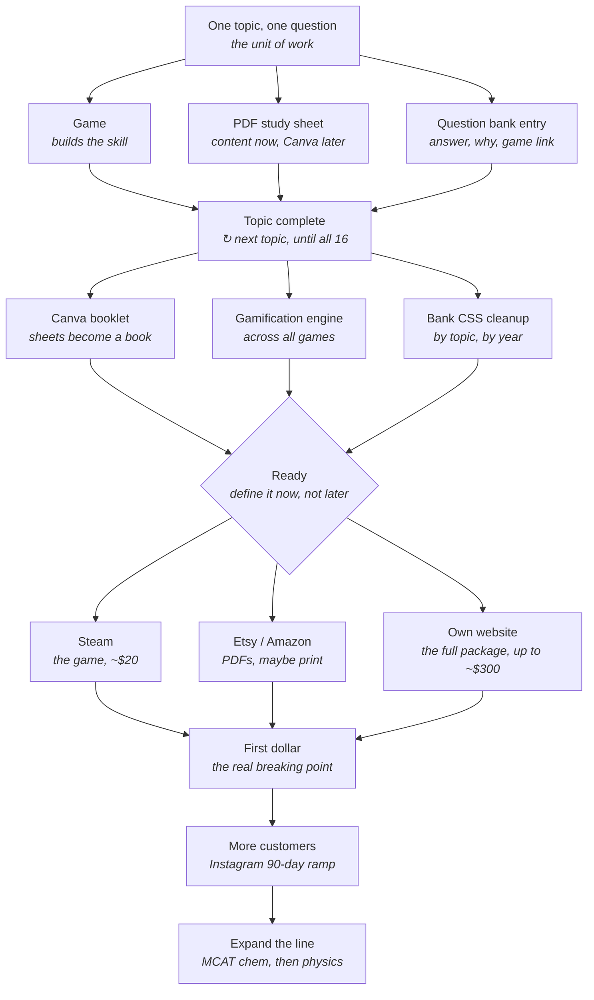
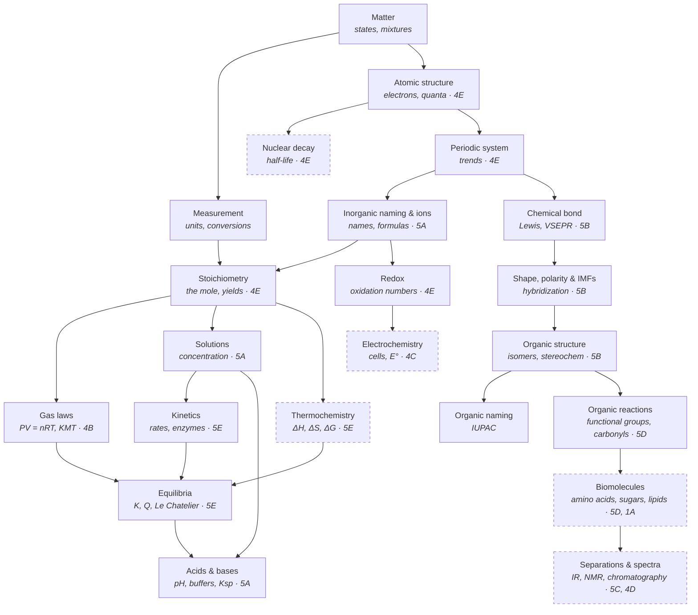

# Track Maps — business process, IMAT tree, MCAT tree

**Status:** drafts from discussion (2026-10-03); arrows are Claude's prerequisite guesses, awaiting Dalia's red pen.
**Relationship to `TOPIC_UNIVERSE_PLAN.md`:** that doc defines the 18-topic universe and its chapters. This doc draws *pathways over it*: the order in which a track walks the topics, and the business process that turns each topic into product.

Diagrams are Mermaid; GitHub renders them inline.

---

## 1 · The business process

Four steps: create the product → first dollar → more customers → expand. Everything in the loop at the top is step 1. "Ready" is drawn as a box on purpose: it gets a written definition *before* the build gets tedious, so a later anxious self can't move the line.

The three things built per unit of work are the same three things sold: game → Steam, PDF sheet → Etsy, question bank → own website.

Notes from the conversation that the boxes can't hold:
- Promotion (Instagram, website, Steam page) does not start until "Ready". Presale makes sense before the *product* is ready but not before *Dalia* is ready.
- Instagram ramp (from the YouTube-millionaire plan): month 1 one reel/week, month 2 two to three, month 3 four to five; slip → restart; after 90 clean days, post like a pro (one sales funnel, one connection piece, one carousel per day). "Comment the word" → automated DM with the website link.
- The website carries: Steam link, Etsy link, a PDF download that needs no Etsy account, the question bank, the package purchase, a little about Dalia.
- Etsy risk noted and accepted: anything sold separately can be bought and copied. Packaging (games + bank + booklet) is the moat, not the PDFs.

---

## 2 · The universe prerequisite graph

One graph, drawn once, for every topic the universe holds or will hold. An arrow means "you need the tail before the head makes sense." Tracks (section 3) do not get their own graphs; they are ordered subsets of this one.

Dashed = topic exists in the plan but is empty today (no topic screen, no games). Codes in italics are AAMC MCAT content categories, kept here because the MCAT is the only track with a published outline to cite.

Three lanes, read top to bottom: **quantitative** (Measurement → Stoichiometry → Gas laws / Solutions / Thermo → Kinetics / Equilibria → Acids & bases), **atoms and naming** (Atomic → Periodic → Naming → Redox → Electrochem), **structure and organic** (Bond → Shape & IMFs → Organic structure → naming / reactions → Biomolecules → Lab). The lanes are independent enough to build in any order; Stoichiometry is the one merge point everything quantitative waits on.

Where the graph differs from `TOPIC_UNIVERSE_PLAN.md`: the plan's "Beyond" chapter (nuclear, coordination, spectroscopy) appears here as Nuclear decay and Separations & spectra, and Biomolecules is a new node the plan does not have. Both are MCAT-driven; the plan should absorb them when the MCAT track is actually built.

**Arrows are drafts.** They are Claude's prerequisite guesses awaiting Dalia's red pen. The games themselves do not depend on them: a game belongs to a topic, a topic is a node, and the arrows only decide suggested order.

---

## 3 · Tracks are ordered subsets

A track is a list of topic IDs in a stated order, plus a short note on emphasis. Nothing else. It is never a second graph, and a student on one track never sees the other track's extra nodes.

### IMAT

Order approved 2026-08-12 ("OK for now"):

matter → atomic structure → periodic system → chemical bond (+ shape & IMFs) → inorganic naming → measurement → stoichiometry → solutions → gas laws → equilibria → acids & bases → kinetics → redox (oxidation numbers only) → organic structure → organic naming → organic reactions.

- Off the track: nuclear, electrochemistry, thermochemistry, biomolecules, separations & spectra.
- Time-short cut line (from the 184-question bank): acids & bases, stoichiometry, equilibria, atomic/periodic, redox ≈ 85% of what is asked.
- Chemical bond is the most-tagged topic with the fewest games.
- Organic reactions are dead since 2014; lowest priority.

### MCAT (draft, unverified)

Source caveat: the AAMC content-outline pages block automated readers; this comes from UWorld's summary plus the outline's known structure. Verify against the official "What's on the MCAT Exam?" PDF before building.

Suggested order (follows the graph; the quantitative lane first because it carries ~30% of Chem/Phys):

atomic structure → nuclear decay → periodic system → inorganic naming & ions → stoichiometry → redox → electrochemistry → gas laws → solutions → thermochemistry → kinetics → equilibria → acids & bases → chemical bond → shape & IMFs → organic structure → organic reactions (functional groups) → biomolecules → separations & spectra.

- Chem/Phys section: 59 questions, 95 min; gen chem ≈30%, organic ≈15%, biochem ≈25%, physics ≈25%, biology ≈5%. Gen chem is also ≈5% of Bio/Biochem.
- Passage-based and reasoning-heavy; recall alone scores little. Game design for this track should lean on the "construct the answer" rule more than on recall decks.
- Organic naming is minor on the MCAT; organic is functional-group chemistry (carbonyls, alcohols, acids and derivatives) plus stereochemistry.
- New work relative to IMAT = exactly the five dashed nodes in the graph. Everything else is shared.

### Gen chem, by book

Same universe, same games, a different order per textbook. Every intro text covers the same topics; they differ in sequence (atoms-first vs reactions-first, where the mole lands, when gases appear). So a "Gen chem" track is really a family of tracks, one per book, each just an ordered list of topic IDs mapped from that book's chapter order.

Student flow: pick a track (IMAT / MCAT / Gen chem course) → if Gen chem, pick the book → the games are suggested in that book's chapter order.

Books are not specified yet. Candidates already in `_teaching-materials/` (Tro's Intro Chem for CHEM 101, the Reactions-First text for CHEM 110–111, OU's 1315/1415 sequence) are obvious first entries, since Dalia's own course plans for them exist, but the list is deliberately left open. Adding a book is a data entry (one ordered list), not a build.

---

## What this means for the code

- A topic has an ID, a screen, games. (Exists: `shared/js/topic-screen.js`.)
- The prerequisite graph is one data file: `{ topicId: [prerequisiteIds] }`. Optional; it only drives suggestions.
- A track is one data file: `{ id, name, order: [topicIds], notes }`. Gen chem books are tracks with a `book` field.
- Track selection is a home-page filter and ordering, not gating (decision 2026-08-11: no gating, ever).

Sources: [UWorld MCAT general chemistry overview](https://gradschool.uworld.com/mcat/sections-subjects/general-chemistry/) · AAMC "What's on the MCAT Exam?" (students-residents.aamc.org, not machine-readable; read manually).
